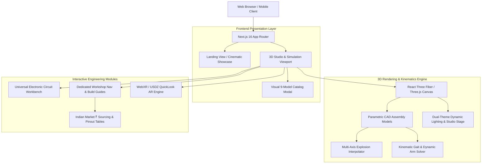
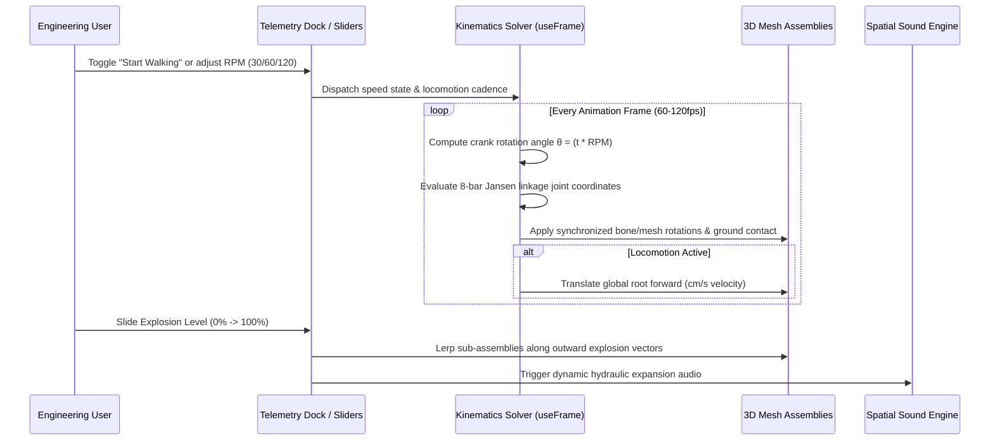
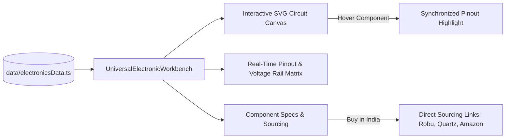

# 🚀 MECHVERSE — Interactive 3D Engineering & Hardware Simulation Platform

<div align="center">


<p align="center">
  <strong>Design, Simulate & Physically Build Real Engineering Machines.</strong><br/>
  An open-source WebGL CAE (Computer-Aided Engineering) studio bridging digital 3D parametric CAD models with real-world robotics, kinematics, electronics schematics, and Indian-market BOM sourcing.
</p>

[Explore 3D Studio](#-9-featured-engineering-models) • [System Architecture](#-system-architecture) • [Getting Started](#-getting-started) • [Hardware Build Guides](#-hardware-build-guides--indian-bom-)

</div>

---

## 🌟 Platform Capabilities

- 🕹️ **Photorealistic Real-Time 3D Viewport**: Built on WebGL, Three.js, and React Three Fiber with studio lighting, reflective floor grids, and full OrbitControls.
- 💥 **Smooth Multi-Axis Exploded View**: Explode complex assemblies layer-by-layer with continuous 0–100% slider control, audio feedback, and component isolation.
- ⚡ **Universal Interactive Circuit Workbench**: Color-coded SVG electrical wiring diagrams, real-time pinout matrices, component descriptions, voltage rails, and direct Indian supplier purchase links across all active models.
- 🤖 **Real-Time Kinematics & Physics Simulators**:
  - **Theo Jansen Strandbeest**: 8-leg planar linkage with real RPM cadence, forward walking ground-contact locomotion, and in-place bench inspection.
  - **Ropeway Climbing Robot**: Reciprocating crank-slider climbing arms, synchronized geared feet, and cable traversal.
  - **Robo Rumble Beetleweight**: 4WD combat arena with weapon spin, obstacle track, and vehicle spec comparison.
  - **ESP32 & Drone B UAVs**: 400Hz PID attitude stabilization, hovering physics, and virtual smartphone HUD controller.
- 📱 **Floor-Anchored Web AR**: Instant augmented reality projection on real-world floors and desks via WebXR / QuickLook USDZ.
- 🎨 **Deep Interactive Customizer**: Real-time paint finish customization (metallic, matte, carbon fiber), body accents, spoilers, and rims.
- 🌗 **True Dual-Theme Studio**: Handcrafted High-Contrast Light Mode and Immersive Dark Cyberpunk Studio.
- 📦 **Visual 9-Machine Catalog**: Instant thumbnail gallery and quick-switch modal displaying images, DOF, AUW, and motor specifications.

---

## 📐 System Architecture

### High-Level Architecture



---

### Kinematics & Mechanics Simulation Engine



---

### Universal Electronics Workbench Data Flow



---

## 🤖 9 Featured Engineering Models

| # | Machine | Category | Tech Specs & Drive System | Interactive Features |
|---|---|---|---|---|
| 1 | **Robo-Racer Bot** | AI Autonomous Rover | ESP32, Dual N20 Micro-Gearmotors, LiDAR CAD, 2S LiPo | SolidWorks CAD, Exploded View, Circuit Schematic, Indian BOM (₹2,888) |
| 2 | **AERO-ESP Drone** | Smartphone Wi-Fi Quad | ESP32-WROOM SoftAP, MPU6050 400Hz PID, 8520 Coreless, 1S LiPo | Virtual Touch HUD, Exploded View, Flight Dynamics, Indian BOM (₹1,955) |
| 3 | **Drone-B Octocopter** | Industrial Heavy UAV | Coaxial Carbon Lattice, 8x High-Thrust BLDC Motors, 6S Power | Exploded View, Coaxial Propeller Simulation, Avionics Schematic |
| 4 | **AERO-450 Drone** | Pixhawk Quadcopter | APM 2.8 / Pixhawk, 2212 920KV BLDCs, 30A ESCs, 3S 2200mAh | Real-Life Sourcing, Exploded Structure, Telemetry Wiring |
| 5 | **Robo Rumble** | Combat Battle Robot | 1.5kg Beetleweight, Hardox Steel Wedge, 4WD High-Torque Motors | 3D CAD Explorer, Battle Arena, Obstacle Track, Customizer, Compare |
| 6 | **Apex GT Supercar** | Twin-Turbo V6 GT | Mid-Mounted Twin-Turbo V6, Carbon Monocoque, Pushrod Suspension | Aerodynamic Parts Customizer, Color Paint Finishes, Rim Styles |
| 7 | **Walking Robot (Strider-X1)** | Theo Jansen Biomimetic | 8-Leg Jansen Mechanism, Planetary DC Gearbox, 3V Power | Sleek Telemetry Dock, 30/60/120 RPM Cadence, In-Place vs Walk Mode |
| 8 | **Electric Fan** | Aerodynamics & Fluid | 3-Blade Aerofoil Rotor, 3-Speed AC Induction Motor, Oscillation | Multi-Axis Disassembly, Airflow Vortex Simulation, Mechanical BOM |
| 9 | **Ropeway Climbing Robot** | Cable Inspection Climber | Reciprocating Dual Gripper Arms, 12V 100RPM Geared DC, Limit Switches | Arm Kinematic Motion, Exploded CAD, DPDT Reversing Circuit Workbench |

---

## 🛠️ Tech Stack

- **Framework**: [Next.js 16](https://nextjs.org/) (Turbopack, App Router, React 19)
- **3D Graphics**: [Three.js](https://threejs.org/), [@react-three/fiber](https://r3f.docs.pmnd.rs/), [@react-three/drei](https://github.com/pmndrs/drei)
- **Languages**: TypeScript (Strict Type Safety)
- **Styling**: Tailwind CSS 3.4, Lucide React Icons, Glassmorphism
- **Simulation**: Custom numerical kinematic solvers, PID loops, vector physics
- **Augmented Reality**: WebXR Device API, USDZ QuickLook for iOS

---

## 🚀 Getting Started

### Prerequisites

- **Node.js**: v18.18.0 or higher
- **npm** or **pnpm** or **yarn**

### 1. Clone the repository

```bash
git clone https://github.com/yashharfode/Mechverse.git
cd Mechverse
```

### 2. Install dependencies

```bash
npm install
```

### 3. Run development server

```bash
npm run dev
```

Open [http://localhost:3000](http://localhost:3000) in your browser.

### 4. Build for Production

```bash
npm run build
npm run start
```

---

## 📁 Repository Structure

```
Mechverse/
├── app/
│   ├── layout.tsx                # Root HTML layout & fonts
│   ├── page.tsx                  # Main application orchestrator (Landing & 3D Studio)
│   └── globals.css               # Design tokens, custom scrollbars, animations
├── components/
│   ├── 3d/                       # Parametric 3D WebGL Models
│   │   ├── Aero450DroneModel.tsx
│   │   ├── DroneBModel.tsx
│   │   ├── ElectricFanModel.tsx
│   │   ├── Esp32DroneModel.tsx
│   │   ├── RoboRacerModel.tsx
│   │   ├── RoboRumbleVehicleModel.tsx
│   │   ├── RopewayRobotModel.tsx
│   │   ├── SceneViewer.tsx       # OrbitControls, stage lighting & background
│   │   ├── SportsCarModel.tsx
│   │   └── WalkingRobotModel.tsx
│   ├── electronics/              # Universal Interactive Circuit Workbench
│   │   └── UniversalElectronicWorkbench.tsx
│   ├── hero/                     # Hero 3D interactive stage
│   ├── landing/                  # Landing page sections & showcases
│   │   ├── HeroScene.tsx         # CAD HUD callouts, leader lines & 3D models
│   │   ├── LandingNavbar.tsx
│   │   ├── CatalogGrid.tsx
│   │   └── ExplodedView.tsx
│   ├── robot/                    # Strider-X1 Kinematic Dock & Workshop Nav
│   │   ├── RobotWalkingControls.tsx
│   │   └── RobotWorkshopNav.tsx
│   ├── roborumble/               # Robo-Rumble subtabs & arena simulator
│   │   └── RoboRumbleWorkshopNav.tsx
│   └── ui/                       # Studio UI components
│       ├── Navbar.tsx            # Model selector & 9-Model Visual Catalog Modal
│       ├── ControlsHeader.tsx    # Exploded, Electronic, View mode toggles
│       ├── BottomToolbar.tsx     # Explosion slider & camera view presets
│       └── WebARModal.tsx        # Augmented reality launcher
├── data/
│   ├── electronicsData.ts        # SVG circuits, pinouts, voltage rails & BOM
│   ├── machinesData.ts           # 3D machine hierarchies & sub-assemblies
│   └── ropewayRobotData.ts       # Ropeway robot CAD & specifications
├── public/
│   ├── images/models/            # High-resolution renders of all 9 models
│   └── models/                   # STL / GLTF / GLB 3D CAD assets
└── types/
    └── machine.ts                # TypeScript domain models & simulation types
```

---

## 📱 Hardware Build Guides & Indian BOM (₹)

Every robot on Mechverse includes a verified, tested hardware guide with components sourced specifically from Indian suppliers (Robu.in, QuartzComponents, Amazon.in):

### Example: AERO-ESP Smartphone Wi-Fi Drone (Under ₹2,000 INR)
1. **Microcontroller**: ESP32 NodeMCU / ESP32-WROOM-32 (~₹280)
2. **IMU**: MPU-6050 6-DOF Accelerometer + Gyroscope (~₹130)
3. **Motors**: 4× 8520 Coreless Brushed Motors (2× CW, 2× CCW) (~₹380)
4. **Propellers**: 55mm Micro Quad Propellers (~₹70)
5. **Drivers**: 4× SI2302 N-Channel MOSFETs + 1N5819 Schottky Flyback Diodes (~₹60)
6. **Battery**: 1S 3.7V 380–500mAh 25C LiPo + TP4056 USB-C Charger (~₹320)
7. **Control Protocol**: Direct Wi-Fi SoftAP Hotspot — zero RC transmitter purchase required!

---

## 🤝 Contributing

Contributions are welcome! Whether it's adding new CAD models, improving kinematics solvers, expanding circuit schematics, or adding more realistic material textures:

1. Fork the Project
2. Create your Feature Branch (`git checkout -b feature/AmazingMachine`)
3. Commit your Changes (`git commit -m 'feat: Add new quadruped robot'`)
4. Push to the Branch (`git push origin feature/AmazingMachine`)
5. Open a Pull Request

---

## 📄 License

Distributed under the **MIT License**. See `LICENSE` for more information.

<div align="center">
  <sub>Engineered with precision for makers and builders worldwide. 🚀</sub>
</div>
